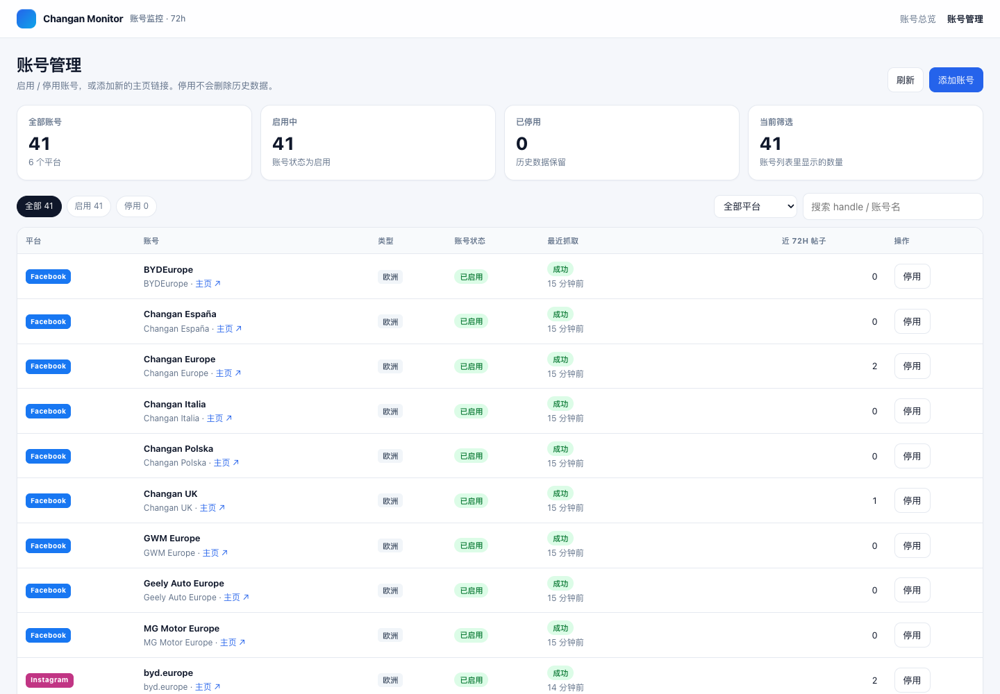
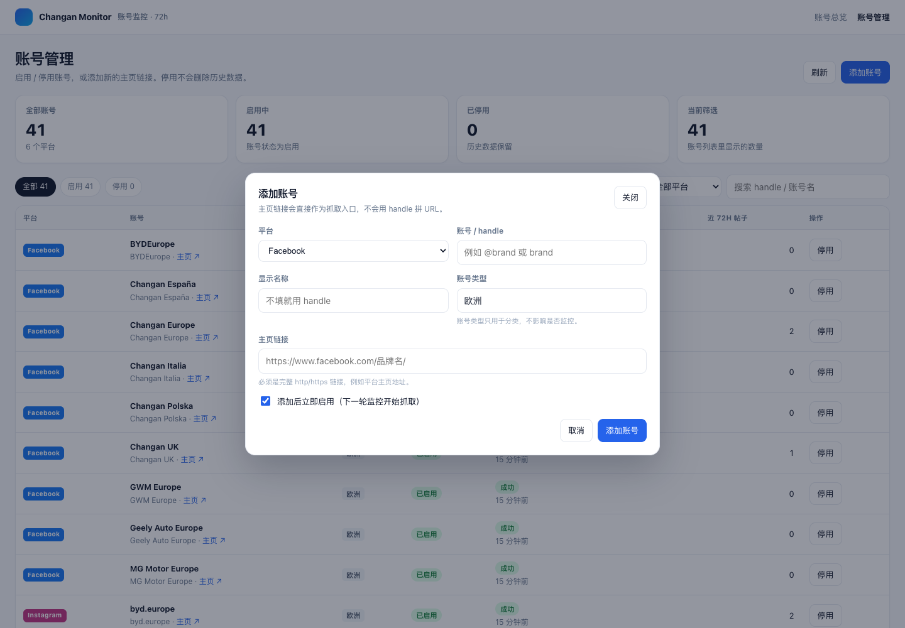

# 运行手册

## 1. 这个项目做什么

- 监控 6 个平台的主页：X、YouTube、Instagram、Facebook、LinkedIn、TikTok。
- 默认从参考库同步欧洲账号；**监控本身不按 `account_type` 过滤，`active = true` 的账号都会抓**。
- 每个周期执行一次；每次窗口是执行时刻往前 72 小时，左闭右开：`[now-72h, now)`。
- 只抓主页帖子列表里可见的帖子，以及账号本身的粉丝/关注/帖子数。
- 窗口内每篇帖子写一条指标快照（`post_metrics`），所以同一帖子跨周期会有多条记录，可以直接算增长。
- 每次周期、每个账号的抓取结果、错误、日志都落库，失败不会静默。

## 2. 数据库

新库：`changan_monitor`（和参考项目同一个 PG 实例、同一个账号，只是库名不同）。

| 表 | 作用 |
|---|---|
| `platforms` | 6 个平台 |
| `accounts` | 账号 + 主页链接（`profile_url`） |
| `monitor_cycles` | 一次监控周期，带 72h 窗口 |
| `monitor_runs` | 周期内某个账号的一次抓取 |
| `posts` | 帖子身份（平台、账号、external_id、url、发布时间） |
| `post_metrics` | 某次 run 的帖子指标快照 |
| `account_metrics` | 某次 run 的账号指标快照 |
| `run_logs` | 步骤日志 |

视图：

- `v_cycle_summary`：每个周期的状态、账号数、帖子快照数。
- `v_latest_post_metrics`：每篇帖子最新一次指标。
- `v_post_growth`：同一帖子相邻快照的指标增量。

## 3. 首次配置

```bash
cd /Users/fuhui/outsourcing-projects/changan-monitor
pnpm install
pnpm run db:init
pnpm run db:sync-accounts
```

`db:sync-accounts` 会连参考库的 `changan_social_data`，把 `social_accounts.account_type = '欧洲'` 的启用账号同步到 `accounts`。目前是 41 个。

同步只影响“导入哪些账号”，不影响监控选择：同步进来或手工新增的账号，只要 `active = true` 都会进入下一轮监控。

| 平台 | 账号数 |
|---|---:|
| facebook | 9 |
| instagram | 9 |
| linkedin | 7 |
| tiktok | 8 |
| x | 2 |
| youtube | 6 |

## 4. 登录

X / YouTube / Instagram / TikTok 已经改成 TikHub API，不需要浏览器登录。
只有 Facebook / LinkedIn 需要独立 Playwright profile：`work/playwright-profile`。

```bash
pnpm run login --platform facebook
pnpm run login --platform linkedin
```

`--platform all` 现在也只会打开这两个平台。每打开一个，在浏览器里完成登录，然后回终端按 Enter。

## 5. 跑一轮

```bash
pnpm run monitor
```

测试时只跑某个平台/账号：

```bash
pnpm run monitor --platform x
pnpm run monitor --platform youtube --account "BYD Europe"
pnpm run monitor --platform tiktok --limit 1
```

常用环境变量（`.env`）：

| 变量 | 默认 | 说明 |
|---|---|---|
| `SYNC_ACCOUNT_TYPE` | `欧洲` | `db:sync-accounts` 从参考库导入哪类账号；不影响监控 |
| `MONITOR_WINDOW_HOURS` | `72` | 窗口小时数 |
| `MONITOR_CONCURRENCY` | `3` | 并发账号数 |
| `MONITOR_ACCOUNT_TIMEOUT_MS` | `300000` | 单账号超时 |
| `FACEBOOK_FIRST_SCREEN_RETRIES` | `2` | Facebook 首屏卡死时重载次数，0 = 关闭 |
| `FACEBOOK_FIRST_SCREEN_RETRY_BUDGET_MS` | `180000` | 首屏等待 + 重载的总预算 |
| `MONITOR_HEADLESS` | `0` | 0=有头浏览器，1=无头 |
| `MONITOR_USER_DATA_DIR` | `work/playwright-profile` | 浏览器 profile |
| `TIKHUB_API_KEY` | 空 | X / YouTube / Instagram / TikTok 共用 |
| `TIKHUB_MIN_INTERVAL_MS` | `80` | TikHub 请求最小间隔 |

运行逻辑：

1. 取 PG advisory lock；上一轮没结束就跳过。
2. 读 `accounts` 里 `active = true` 的账号（不按 `account_type` 过滤）。
3. 建 `monitor_cycles`，窗口 `[now-72h, now)`。
4. 每个账号建 `monitor_runs`，按平台 adapter 抓取。
5. 帖子和指标在一个事务里写入；成功/失败都更新 run。
6. 周期结束更新 `monitor_cycles` 汇总；有失败进程退出码为 1。

## 6. 每小时定时

macOS launchd：

```bash
cp deploy/com.changan.monitor.plist ~/Library/LaunchAgents/
launchctl load ~/Library/LaunchAgents/com.changan.monitor.plist
```

查看/停止：

```bash
launchctl list | grep changan.monitor
launchctl unload ~/Library/LaunchAgents/com.changan.monitor.plist
```

日志：

- `logs/monitor.log`：每轮抓取日志
- `logs/launchd.out.log` / `logs/launchd.err.log`：launchd 自身日志

注意：Mac 休眠会漏跑；要严格每小时，建议放一台不休眠的机器/服务器。

## 7. 常用查询

最近 10 个周期：

```sql
select id, status, window_start_ts_ms, window_end_ts_ms, total_runs, success_runs, failed_runs, post_snapshots
from v_cycle_summary
order by started_ts_ms desc
limit 10;
```

某篇帖子的指标变化：

```sql
select p.url, pm.captured_ts_ms, pm.views, pm.likes, pm.comments, pm.shares
from post_metrics pm
join posts p on p.id = pm.post_id
where p.url = '...'
order by pm.captured_ts_ms;
```

最近一次各账号抓取结果：

```sql
select a.platform_code, a.handle, r.status, r.posts_found, r.posts_saved, r.error_message
from monitor_runs r
join accounts a on a.id = r.account_id
where r.cycle_id = (select id from monitor_cycles order by started_ts_ms desc limit 1)
order by a.platform_code, a.handle;
```

## 8. 已知限制 / 排错

- **数据源**：X / YouTube / Instagram / TikTok 走 TikHub API，不需要浏览器登录；Facebook / LinkedIn 走浏览器，需要登录。登录失效时 run 会失败并写 `LOGIN_REQUIRED` 类错误，重新跑 `pnpm run login --platform <平台>`。
- **TikHub key**：`.env` 里的 `TIKHUB_API_KEY` 是 4 个 API 平台共用的；缺失、过期、额度不足会直接报 401/402/429，不会静默跳过。`TIKHUB_MIN_INTERVAL_MS` 控制请求间隔，默认 80ms。
- **Instagram 降级**：用户帖子列表先走 v1 `fetch_user_posts`，失败或缺 `taken_at` 时降级 v2 `fetch_user_posts`；某条帖子列表里没有指标时，再按 v2 `fetch_post_info` → v1 `fetch_post_by_url` 取单帖指标。降级会写 `warn` 日志。
- **X**：TikHub 用户资料 + 用户发帖时间线；接口返回什么就入库什么。
- **YouTube**：TikHub `get_channel_videos` + `get_channel_shorts` 拿列表，再逐条 `get_video_info` 取精确发布时间/播放/点赞/评论。72h 内视频多时会多花 API 请求。
- **TikTok**：TikHub 先解析 `sec_user_id`，再取用户资料和主页作品列表。
- **系统代理**：API 平台只走 Node 直连 TikHub，不依赖 Chrome 代理；Facebook / LinkedIn 的浏览器仍然走系统代理。
- **0 帖**：账号 72h 没发帖是正常成功，`posts_found=0`，不是失败。
- **Facebook 首屏卡死**：主页右栏停在骨架屏、底部显示“用时超出预期”时，首屏一张帖子卡片都没有，滚动也拿不到帖子。adapter 会自动重载页面重试（默认 2 次，日志 `facebook_retry`），仍失败则报 `FACEBOOK_FIRST_SCREEN_TIMEOUT`；重试次数和预算见上面的 `FACEBOOK_FIRST_SCREEN_*`。离线回归：`pnpm run fb:retry`。
- **LinkedIn 新版 sdui**：公司动态页已经没有 DOM 卡片，帖子来自首屏文档 + `flagship-web/rsc-action/actions/pagination`。滚动会一直抓到“最早帖子早于 72h”为止，日志 `pagination` 记录分页份数和最早时间。出现 0 帖时先看 `interface_mode` 的 `httpStatus / docBytes / rscActivityIds / paginationBodies`：
  - `httpStatus=999` 或 `docBytes=0`：登录态失效或被风控，重新跑 `pnpm run login --platform linkedin`；
  - 有 `paginationBodies` 但 `rscActivityIds=0`：多半是页面结构又改了，保存一份 probe 报告再改解析；
  - 新版路径不产出正文，`text` 为空是已知限制。离线回归：`pnpm run li:pag`。
- **周期重叠**：每小时一轮意味着每篇帖子最多 72 条快照；`post_metrics` 的唯一键是 `(run_id, post_id)`，不会重复。
- **并发**：默认 3。LinkedIn/Facebook 如果触发风控，调小 `MONITOR_CONCURRENCY`。


## 9. Web 页面

`web/` 是 TanStack Start 应用，直接读 `changan_monitor`，不经过爬虫进程。

### 启动

```bash
cd /Users/fuhui/outsourcing-projects/changan-monitor/web
pnpm install
pnpm dev
```

打开 <http://127.0.0.1:3000/account-monitor/>。也可以在项目根目录跑：

```bash
pnpm run web:dev
```

`web/src/server/db.ts` 会依次尝试 `web/.env`、项目根 `.env`，不需要重复配置数据库。

### 页面结构

| 路径 | 内容 |
|---|---|
| `/account-monitor/` | 账号列表：平台筛选、搜索、粉丝/帖子数/近 72h 帖子/快照数/最近抓取/状态 |
| `/account-monitor/accounts/:accountId` | 账号详情：账号指标 + 帖子列表（近 72h / 全部历史） |
| `/account-monitor/accounts/:accountId/posts/:postId` | 帖子详情：最新指标、增长、4 张趋势图、全部快照、原始 JSON、CSV 导出 |
| `/account-monitor/manage/accounts` | 账号管理：启用/停用账号、添加账号 |

账号管理说明：

- 停用不会删除历史数据，只是不再进入新的监控周期；启用后下一轮开始抓取。
- 新增账号默认启用，下一轮监控开始处理。
- 只要账号是启用状态（`active = true`），就会进入下一轮监控；`account_type` 只是分类标签，不影响是否抓取。
- 目前不做物理删除，避免误删历史数据。
- 重新跑 `pnpm run db:sync-accounts` 只会更新账号资料，**不会覆盖**在 Web 里设置的启用/停用状态。





### 数据口径

- “近 72h 帖子”按帖子发布时间过滤，不是按入库时间。
- “快照”是 `post_metrics` 里这个帖子目前的记录数，不是固定 72 条。
- 一篇帖子最完整约 72 条：每小时一条、帖子一直在 72h 窗口内。实际会少，原因包括：
  - 帖子是刚发布的，还没满 72h；
  - 账号刚加入监控；
  - 某几轮抓取失败，或上一轮没跑完被锁跳过；
  - 帖子被删除/隐藏，平台不再返回；
  - 平台发布时间只能到日期，边界会有误差。
- 帖子详情会把相邻快照间隔超过 1.5 小时的记录标出来，方便看缺口。

### 构建

```bash
pnpm run web:build
```

本地开发用 `pnpm dev`。生产部署用 `pnpm build` 生成自包含的 `.output`，再按 [Web 部署手册](web-deploy.md) 部署到 Linux + Nginx；服务器不需要安装 pnpm 依赖。


## 10. Windows 运行

Windows 不能用 `deploy/com.changan.monitor.plist`（那是 macOS launchd 专用）。
启动、关闭、查看日志、常见问题全部整理在：

[Windows 定时任务手册](windows-task.md)
